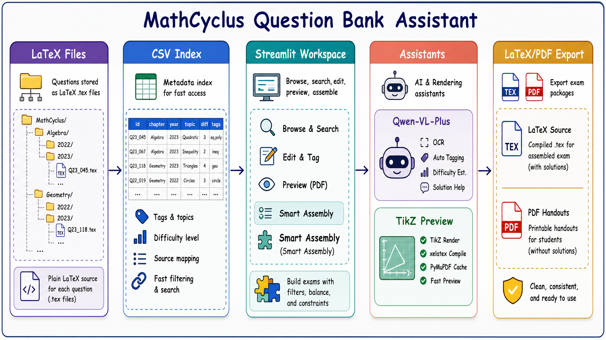

# 📚 乌托邦高中物理题库助手

UtopiaPhyCyclus（乌托邦高中物理题库助手）面向高中物理教师和教研团队，支持 LaTeX 题目录入、检索、编校和组卷。Windows 桌面版集成 PDF 审阅与项目工作台，也可通过 Streamlit 在浏览器中使用经典界面。

本项目基于 **JinLingxi（槿灵兮）** 的 [MathCyclus 数学题库助手](https://github.com/JinLingxi/MathCyclus---Lingxi-Question-Bank-Assistant) 改造，物理版由 [YJW2000](https://github.com/YJW2000) 维护。原作 MIT 许可及署名见 [LICENSE](LICENSE) 和 [NOTICE.md](NOTICE.md)。

- **Windows x64 桌面预览版** [下载 v1.2.0-desktop.12 安装器](https://github.com/YJW2000/UtopiaPhyCyclus/releases/download/v1.2.0-desktop.12/UtopiaPhyCyclus-Desktop-Preview-1.2.0-desktop.12-windows-x64.exe) · [发行说明与校验值](https://github.com/YJW2000/UtopiaPhyCyclus/releases/tag/v1.2.0-desktop.12)
- **Windows x64 经典便携版** [下载 v1.2.0 ZIP](https://github.com/YJW2000/UtopiaPhyCyclus/releases/download/v1.2.0/UtopiaPhyCyclus-1.2.0-windows-x64.zip)，完整解压后双击 `UtopiaPhyCyclus.exe`。

桌面版安装后，在「设置 → 本地题库」中选择原来包含 `chapters` 的目录即可继续使用已有题库。「架构介绍」提供截图教程和「规范指南」，「TeX 录入」可打开演示题。更多说明见[安装与重新构建](docs/发行与安装.md)和[更新记录](CHANGELOG.md)。

**空题库发行：** 仓库和所有发行包仅提供软件、空白组卷模板及文档，不包含内部题目、图片、答案、索引、密钥或导出文件。请自行导入有权使用的题目。构建时使用显式白名单，独立仓库不携带旧题库的 Git 历史。

**v1.2.0 Windows x64 完整版**内置 Python、项目所需 TeX Live 宏包及中文字体、Node、CPU Whisper 和 small 多语言模型。完整解压后运行 exe，即可使用题库和排版功能。AI 功能通过已登录的本机 Agent 使用。预装宏包范围、x32 限制与测试边界见 [Windows兼容性与测试](docs/Windows兼容性与测试.md)。下面的环境安装步骤适用于源码/wheel 用户。

## ☕ 请我喝咖啡

如果这个项目帮到了你，欢迎请我喝杯咖啡，支持物理版的后续维护。感谢你的支持！


## 🧭 系统工作流



从按章节/年份组织的 LaTeX 题目源文件出发，系统构建 SQLite 元数据与中文全文检索索引，在工作台中完成检索、编辑、预览与智能组卷。本机 Agent 协助识图、打标签和生成解答，TikZ 用于物理示意图排版。组卷后可导出 LaTeX 源文件与 PDF 讲义。

## ✨ 核心功能

### 📝 题库管理

面向 LaTeX 题目源文件的结构化管理流程。

- 按「板块 / 年份」自动归档题目文件。
- 使用 `problem`、`answer`、`solutions` 环境分离题干、答案与解析。
- 通过题目元数据记录 ID、标签、难度、来源与备注。

### 🤖 AI 辅助录入

使用本机 Agent 处理截图、标签和解答生成。

- 在桌面版「图片识别」中粘贴截图或选择图片，再选择识别模型并点击「开始识别并编译」。PDF 编译成功后自动打开工作台，可以并排编辑 LaTeX 源码和查看 PDF。
- 自动生成知识点标签与难度星级。
- 对解答进行“教学审核”，发现逻辑问题时附加 AI 纠错说明。

### 🧠 智能组卷

从题库中按条件筛选、抽样并生成试卷。

- 支持题型、年份、板块、标签、难度与全文检索。
- 侧边栏“题目查找”提供本地精确查找和模糊查找。模糊查找匹配正文、标签、知识点、物理方法、答案解析及来源信息，支持常见物理关联词、多关键词和近似词，可按相关度、首次录入时间或难度排序，并显示命中字段与分页结果。
- 支持按知识板块、题量与目标难度分布进行抽样。
- 支持自然语言组卷需求润色，辅助形成命题意图。

### 项目工作台

- 「全局浏览」可按知识板块、试卷或录入顺序查看题目。左侧选题后，右侧项目工作台打开该题的 PDF，可直接预览和批注。切换到「题库文稿」可编辑题库草稿的 LaTeX。
- 桌面版内置 Papilot 0.14.1，支持多文件 LaTeX 项目、PDF 批注、Agent 改动审阅及 Git 版本管理。
- 其他录入页面的题目可通过「更多操作 → 在项目工作台打开」进入项目。审阅后回到题目工作台，用「从项目工作台导入改动」同步源码和依赖，核对排版后再保存。[项目工作台教程](docs/Papilot%20工作台.md)

### PDF 录入与框选修改

桌面版在「PDF 录入」中打开原卷，点击「识别原卷」并选择页码。经典版在上传后点击「识别所选页并生成草稿」。本地视觉 Agent 根据页面图像和可提取的文字重建题目、公式及原卷附带的答案与解析，也可处理扫描件。照片和仪器读数等插图从原 PDF 裁取，入库时随题目存入「相关图」目录。

草稿编译后，在 PDF 上框住要改的文字、公式或 TikZ 图形，用中文描述要求，点击「生成修改预览」。可以对照修改前后的排版，点击「采用修改」更新草稿，再用「保存到题库」入库。「LaTeX 源码」可查看和手动编辑底稿，「原 PDF 对照」可核对识别结果。已经有 TeX 文件或题库题目时，也可以从「TeX 录入」或「全局浏览」打开框选编辑。

桌面版在「设置」里选择本地 Agent，沿用对应命令行工具的登录。设置页可以检测 Git、LaTeX 和各个 Agent，缺少的工具可从对应行安装。处理扫描件或 PDF 框选时，请选择支持图片的 Agent。PDF 在本机用 XeLaTeX 编译，页面图像或选区截图及相应文字会交给所选 Agent 处理。单独运行 Streamlit 版时，PDF 识别与框选仍使用本机 Codex CLI，首次使用可运行 `codex login` 登录。

新题草稿和已入库题目都可以点击「补充答案与解析」。Agent 根据题干、选项、插图和已有解答补全缺失项。核对生成内容后，新题可保存入库，旧题可保存回原题。单独运行 Streamlit 时，补充解答使用本机 Codex CLI。

在「全局浏览」打开「批量补充答案与解析」，可跨页勾选题目，再让 Agent 逐题补齐缺失的内容。生成完成后可逐题核对并保存，已有答案和解析会保留。

### 📐 TikZ 物理示意图预览

将物理示意图、光路图、电路图和几何辅助图代码直接嵌入题目编辑与预览链路。

- 通过 `xelatex` 编译 TikZ 图形。
- 使用 `PyMuPDF` 将编译结果转为 PNG 预览。
- 基于文件修改时间缓存，减少重复渲染开销。

题目也支持外部图片：在单题录入、TeX 录入或题目源码编辑中展开「🖼️ 插入外部图片」，上传 PNG/JPEG/WebP，选择题干末尾、解析末尾或源码中的 `% 插图位置`。已有 `\includegraphics` 文件名的源码可选择「关联源码中的同名图片」，或在 TeX 录入中指定本地资源目录。

识别图片或 PDF 页面时，照片、复杂仪器读数图等不适合 TikZ 重绘的插图会自动定位并从原始分辨率裁剪为 PNG，直接在所属题干、选项、答案或解析中插入真实图片引用，无需再次上传。多图和跨页识别按输入页编号匹配；定位标记无效时自动重试一次，仍失败则保留识别草稿并提示，避免漏图入库。

保存后，图片按文件名单独存放在 `<题目文件名> 相关图/`，正文原位保留 `\includegraphics[width=0.65\linewidth]{...}`，由编译器读取。不同内容的同名图片会另存；修改题目标签或组卷导出时会复制相关图片并更新引用，导出目录包含独立的 `images/`。也可以向插图矫正 Agent 上传图片并说「将这张原图插入题目」，Agent 可直接引用原图并执行编译和可选视觉审图。

### 🤖 物理插图矫正 AGENT · Harness v2

工作台内置「物理插图矫正AGENT」，可通过自然语言或语音修正题目中的 TikZ 示意图。
Harness v2 在「LLM 生成 + 编译重试」之上补齐了**确定性校验与真实纠错闭环**：

- **六类确定性校验**：结构 / TikZ 语法 / 数学语义 / 物理图元 / 数值几何 / 可读性，
  检测「能编译但物理不对」的问题（缺力箭头、斜面角度画错、磁场方向缺失、电路未闭合等）。
- **真实编译日志诊断**：保留 XeLaTeX 原始日志，输出「文件:行号 + 错误类别 + 中文修复建议」，
  并把诊断回灌给模型精准自愈；兼容含中文的工作区路径。
- **校验-矫正闭环**：确定性自动修复 → 静态校验 → 编译 → 日志诊断 → 可选多模态视觉审图 →
  反思重生成；保留历史最佳候选。
- **质量门禁**：校验未通过（`fail`）时禁止自动写回题目源码，UI 展示校验得分、
  问题清单、自动修复记录与编译器日志。
- **技能与插件**：内置物理插图验收技能，支持 `services/agent_skills/plugins/` 动态加载外部技能。

详细设计与接口契约见 [`docs/物理插图矫正AGENT_Harness强化说明.md`](docs/物理插图矫正AGENT_Harness强化说明.md)
与 [`docs/harness_v2_contract.md`](docs/harness_v2_contract.md)。

## 🛠️ 技术栈

- **前端界面与交互**为 Electron / React 桌面工作台和 Streamlit 浏览器界面。
- **排版与编译引擎**：**$\LaTeX$** (核心依赖 `xelatex` 编译器)
- **底层脚本与处理**：Python (`re` 文本处理, `fitz` PDF图像解析, 抽样算法)
- **大语言模型支持**：Codex 等本机 Agent
- **版本控制**：Git/GitHub (配置代理优化大文件传输同步)

## 🚀 源码快速启动

1. Windows 一键启动支持 **64 位 CPython 3.10 - 3.12**，推荐 Python 3.12。安装 Python 时建议勾选 **Python Launcher** 和 **Add python.exe to PATH**；若本机只有 Python 3.13 或更高版本，可并行安装 Python 3.12，无需卸载新版。

   `启动乌托邦高中物理题库助手.bat` 会优先通过 Python Launcher 选择 3.12、3.11 或 3.10；Launcher 不可用时会尝试 `PATH` 中的 `python`。首次运行会自动创建 `.venv` 并安装依赖。Windows 便携版内置 Python，无需此步骤。

2. 如需手动创建虚拟环境并安装依赖，可执行：

   ```bash
   python -m venv .venv
   .venv\Scripts\activate
   pip install -r requirements.txt
   ```
3. 如需使用 AI 功能，先登录本机 Agent。桌面版可在「设置 → 模型连接」选择默认 Agent。单独运行 Streamlit 版时，使用 `codex login` 登录本机 Codex。
4. 如需使用 TikZ 几何图预览，请安装完整的 **$\LaTeX$ 编译环境**（例如 TeX Live），并确认 `xelatex` 已加入系统环境变量。项目会通过 `PyMuPDF` 将编译结果转为 PNG 预览。
5. 首次启动会建立 `utils/question_index.sqlite3`，并保留迁移所用的旧 CSV。日常保存使用单题增量更新。桌面版与一键启动器在启动和正常退出时自动检查索引，同步在外部新增或修改的题目。需要彻底重建题库索引时，在题库根目录运行以下命令：

   ```bash
   python utils/init_sqlite_index.py
   ```
6. 双击运行 `启动乌托邦高中物理题库助手.bat`，或者在终端执行：

   ```bash
   python 启动乌托邦高中物理题库助手.py
   ```

   即可自动在浏览器中打开工作台。

也可以直接运行 Streamlit：

```bash
streamlit run utopia_phycyclus_app.py
```

## 💡 创新亮点

- **首创"教学审核"OCR**：AI 识别解答时自动审核逻辑，发现错误会标注原错并附加 AI 纠错，兼顾教学真实性与正确性。
- **严苛的 LaTeX 排版规范**：通过 AI Prompt 强制约束分数显示、括号匹配、中英文混排空格等细节，输出代码可直接用于专业出版。
- **Label Data 元数据系统**：每道题自带 ID、难度星级、标签、备注、引用次数的结构化注释头，实现题目级别的精细化管理。
- **TikZ 深度整合 + 智能缓存**：几何图形编译无缝嵌入编辑流程，基于文件修改时间的缓存机制实现秒级实时预览。

## 📁 核心目录结构

```text
├── chapters/              # 存放按学科板块和年份分类的 LaTeX 题库源文件 (.tex)
├── fig/                   # README 与文档配图
├── desktop/               # Electron / React 桌面工作台
├── utils/                 # 系统核心工具库 (配置、文件读写、TikZ 渲染、CSV 索引管理)
├── Test Paper Group/      # LaTeX 试卷/讲义/练习模板
├── ocr_prompt.txt         # AI OCR 与排版约束的系统提示词（热重载）
├── UtopiaPhyCyclus_book.cls    # LaTeX 自定义文档类
├── utopia_phycyclus_app.py   # 独立运行的经典 Streamlit 版入口
├── 启动乌托邦高中物理题库助手.py             # 守护进程与服务启动脚本
├── 启动乌托邦高中物理题库助手.bat            # Windows 一键启动脚本
├── requirements.txt       # Python 依赖清单
└── env.example            # 环境变量配置模板
```

## 🧹 仓库维护说明

- `utils/question_index.sqlite3` 是本机 SQLite 主索引，支持数据库分页、中文全文检索及单题事务更新，不提交到 Git。迁移确认后可清理旧 CSV；运行 `python utils/init_sqlite_index.py` 从 `.tex` 重建 SQLite 索引，不再自动生成 CSV。迁移与备份说明见 [SQLite 索引升级](docs/SQLite索引升级.md)。
- 新增、修改和活跃度统计随题目变更增量记录在 SQLite 主索引。升级时迁移旧 `utils/local_stats.sqlite3` 的活动记录并保留旧库；已有题目不会被记作今日新增。
- 批量识别或同卷录入遇到已存在的同名题目时，默认保留旧文件并跳过新的识别结果；处理日志会明确标记为“跳过”。
- `log.csv` 是批量导入脚本的运行日志输出；`old_app.py`、`question_bank_app000.py` 和 `SolaireEPDA-master/` 属于历史产物或外部参考内容。当前 `.gitignore` 已将同类文件排除，后续如需清理 Git 跟踪记录，建议单独开 PR 处理。
- TikZ 预览依赖本机 `xelatex`，若未安装 LaTeX，题库浏览与普通组卷仍可使用，但几何图实时预览会受限。

## 📄 开源协议

项目自身代码采用 [MIT License](LICENSE)，保留 MathCyclus 原作者 JinLingxi（槿灵兮）及贡献者署名。衍生关系和上游许可核验记录见 [NOTICE.md](NOTICE.md)。

PDF 依赖 PyMuPDF/MuPDF 使用 AGPL-3.0 / Artifex 商业双许可；本项目按其开源 AGPL-3.0 条款提供完整组合发行版及对应源码访问，不能把整体二进制发行版视为仅受 MIT 约束。许可全文见 [COPYING-AGPL-3.0](COPYING-AGPL-3.0)，其他组件、许可及精确版本源码入口见 [THIRD_PARTY_NOTICES.md](THIRD_PARTY_NOTICES.md)。

## 👥 用户群

问题与建议请提交到 [Issues](https://github.com/YJW2000/UtopiaPhyCyclus/issues)。原作者的社群及历史文章属于原 MathCyclus 项目。
