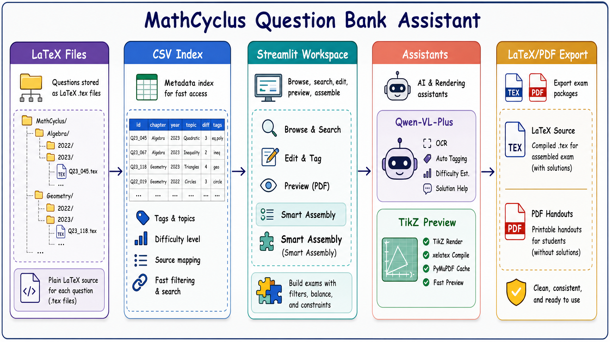

# 📚 乌托邦高中物理题库助手

UtopiaPhyCyclus（乌托邦高中物理题库助手）是一个基于 Python、Streamlit 和 LaTeX 的高中物理题库管理与智能组卷系统。它面向高中物理教师及教研团队，用于解决 LaTeX 题目的结构化管理、检索、排版与组卷问题。

本项目基于 **JinLingxi（槿灵兮）** 的 [MathCyclus 数学题库助手](https://github.com/JinLingxi/MathCyclus---Lingxi-Question-Bank-Assistant) 改造，物理版由 [YJW2000](https://github.com/YJW2000) 维护。原作 MIT 许可及署名见 [LICENSE](LICENSE) 和 [NOTICE.md](NOTICE.md)。

**下载：** [GitHub Releases](https://github.com/YJW2000/UtopiaPhyCyclus/releases) · [安装与重新构建](docs/发行与安装.md) · [更新记录](CHANGELOG.md)。Windows 用户可下载便携 ZIP，完整解压后双击 `UtopiaPhyCyclus.exe`。

**空题库发行：** 仓库和所有发行包仅提供软件、空白组卷模板及文档，不包含内部题目、图片、答案、索引、密钥或导出文件。请自行导入有权使用的题目。构建时使用显式白名单，独立仓库不携带旧题库的 Git 历史。

**v1.1.1 Windows x64 完整版**内置 Python、项目所需 TeX Live 宏包及中文字体、Node、CPU Whisper 和 small 多语言模型。完整解压后运行 exe，AI 功能填写个人 API 即可；无需另外安装 Python、TeX、Node 或 DSH。预装宏包范围、x32 限制与测试边界见 [Windows兼容性与测试](docs/Windows兼容性与测试.md)。下面的环境安装步骤适用于源码/wheel 用户。

## 🧭 系统工作流



从按章节/年份组织的 LaTeX 题目源文件出发，系统构建 CSV 元数据索引，在 Streamlit 工作台中完成检索、编辑、预览与智能组卷，并通过 Qwen3.8-Max 和 TikZ 渲染管线增强 OCR、打标签、解答生成和物理示意图预览能力，最终导出 LaTeX 试卷源文件与 PDF 讲义。

## ✨ 核心功能

### 📝 题库管理

面向 LaTeX 题目源文件的结构化管理流程。

- 按「板块 / 年份」自动归档题目文件。
- 使用 `problem`、`answer`、`solutions` 环境分离题干、答案与解析。
- 通过题目元数据记录 ID、标签、难度、来源与备注。

### 🤖 AI 辅助录入

基于 Qwen-VL-Plus 处理截图、标签和解答生成。

- 识别题目截图并转换为规范 LaTeX。
- 自动生成知识点标签与难度星级。
- 对解答进行“教学审核”，发现逻辑问题时附加 AI 纠错说明。

### 🧠 智能组卷

从题库中按条件筛选、抽样并生成试卷。

- 支持题型、年份、板块、标签、难度与全文检索。
- 支持可选的混合搜索与语义搜索；本地 SQLite 向量索引可随时重建，不替代 CSV 题库索引。
- 支持按知识板块、题量与目标难度分布进行抽样。
- 支持自然语言组卷需求润色，辅助形成命题意图。

### 🎨 工作台界面

采用 Streamlit 构建教师可直接使用的本地工作台。

- 三栏式布局：左侧筛选，中间编辑，右侧预览与 AI 助手。
- 徽章式展示星级、标签、备注等题目状态。
- 支持快速浏览、编辑、预览和组卷流程切换。

### 📐 TikZ 物理示意图预览

将物理示意图、光路图、电路图和几何辅助图代码直接嵌入题目编辑与预览链路。

- 通过 `xelatex` 编译 TikZ 图形。
- 使用 `PyMuPDF` 将编译结果转为 PNG 预览。
- 基于文件修改时间缓存，减少重复渲染开销。

### 🤖 物理插图矫正 AGENT · Harness v2

工作台内置「物理插图矫正AGENT」，可通过自然语言或语音修正题目中的 TikZ 示意图。
Harness v2 在「LLM 生成 + 编译重试」之上补齐了**确定性校验与真实纠错闭环**：

- **六类确定性校验**：结构 / TikZ 语法 / 数学语义 / 物理图元 / 数值几何 / 可读性，
  检测「能编译但物理不对」的问题（缺力箭头、斜面角度画错、磁场方向缺失、电路未闭合等）。
- **真实编译日志诊断**：保留 XeLaTeX 原始日志，输出「文件:行号 + 错误类别 + 中文修复建议」，
  并把诊断回灌给模型精准自愈；兼容含中文的工作区路径。
- **校验-矫正闭环**：确定性自动修复 → 静态校验 → 编译 → 日志诊断 → 可选多模态视觉审图 →
  反思重生成；保留历史最佳候选。
- **质量门禁**：校验未通过（`fail`）时禁止自动写回题目源码，UI 展示校验得分、
  问题清单、自动修复记录与编译器日志。
- **技能与插件**：内置物理插图验收技能，支持 `services/agent_skills/plugins/` 动态加载外部技能。

详细设计与接口契约见 [`docs/物理插图矫正AGENT_Harness强化说明.md`](docs/物理插图矫正AGENT_Harness强化说明.md)
与 [`docs/harness_v2_contract.md`](docs/harness_v2_contract.md)。

## 🛠️ 技术栈

- **前端界面与交互**：[Streamlit](https://streamlit.io/) (响应式框架，多列布局，回调机制)
- **排版与编译引擎**：**$\LaTeX$** (核心依赖 `xelatex` 编译器)
- **底层脚本与处理**：Python (`re` 文本处理, `fitz` PDF图像解析, 抽样算法)
- **大语言模型支持**：阿里云百炼 (Qwen-VL-Plus 模型)
- **版本控制**：Git/GitHub (配置代理优化大文件传输同步)

## 🚀 源码快速启动

1. Windows 一键启动支持 **64 位 CPython 3.10 - 3.12**，推荐 Python 3.12。安装 Python 时建议勾选 **Python Launcher** 和 **Add python.exe to PATH**；若本机只有 Python 3.13 或更高版本，可并行安装 Python 3.12，无需卸载新版。

   `启动乌托邦高中物理题库助手.bat` 会优先通过 Python Launcher 选择 3.12、3.11 或 3.10；Launcher 不可用时会尝试 `PATH` 中的 `python`。首次运行会自动创建 `.venv` 并安装依赖。Windows 便携版内置 Python，无需此步骤。

2. 如需手动创建虚拟环境并安装依赖，可执行：

   ```bash
   python -m venv .venv
   .venv\Scripts\activate
   pip install -r requirements.txt
   ```
3. 复制 `env.example` 为 `.env`，并填入 AI 模型配置：

   ```env
   AI_API_KEY=your_api_key_here
   AI_BASE_URL=https://dashscope.aliyuncs.com/compatible-mode/v1
   AI_MODEL_NAME=qwen3.8-max
   # 可选：启用混合/语义搜索
   AI_EMBEDDING_MODEL_NAME=text-embedding-v4
   ```
   配置 embedding 模型后，在“工具箱 → 语义搜索索引”中更新索引；留空时系统继续使用原有精确筛选。
4. 如需使用 TikZ 几何图预览，请安装完整的 **$\LaTeX$ 编译环境**（例如 TeX Live），并确认 `xelatex` 已加入系统环境变量。项目会通过 `PyMuPDF` 将编译结果转为 PNG 预览。
5. 首次启动时如果本地没有 `utils/题库索引表.csv`，程序会根据当前电脑上的 `chapters/` 自动生成；首次使用或批量导入题目后，也可以手动重建题库索引：

   ```bash
   python utils/init_csv_index.py
   ```
6. 双击运行 `启动乌托邦高中物理题库助手.bat`，或者在终端执行：

   ```bash
   python 启动乌托邦高中物理题库助手.py
   ```

   即可自动在浏览器中打开工作台。

也可以直接运行 Streamlit：

```bash
streamlit run utopia_phycyclus_app.py
```

## 💡 创新亮点

- **首创"教学审核"OCR**：AI 识别解答时自动审核逻辑，发现错误会标注原错并附加 AI 纠错，兼顾教学真实性与正确性。
- **严苛的 LaTeX 排版规范**：通过 AI Prompt 强制约束分数显示、括号匹配、中英文混排空格等细节，输出代码可直接用于专业出版。
- **Label Data 元数据系统**：每道题自带 ID、难度星级、标签、备注、引用次数的结构化注释头，实现题目级别的精细化管理。
- **TikZ 深度整合 + 智能缓存**：几何图形编译无缝嵌入编辑流程，基于文件修改时间的缓存机制实现秒级实时预览。

## 📁 核心目录结构

```text
├── chapters/              # 存放按学科板块和年份分类的 LaTeX 题库源文件 (.tex)
├── fig/                   # README 与文档配图
├── utils/                 # 系统核心工具库 (配置、文件读写、TikZ 渲染、CSV 索引管理)
├── Test Paper Group/      # LaTeX 试卷/讲义/练习模板
├── ocr_prompt.txt         # AI OCR 与排版约束的系统提示词（热重载）
├── UtopiaPhyCyclus_book.cls    # LaTeX 自定义文档类
├── utopia_phycyclus_app.py   # Streamlit 主程序入口 (包含 UI 布局与核心逻辑)
├── 启动乌托邦高中物理题库助手.py             # 守护进程与服务启动脚本
├── 启动乌托邦高中物理题库助手.bat            # Windows 一键启动脚本
├── requirements.txt       # Python 依赖清单
└── env.example            # 环境变量配置模板
```

## 🧹 仓库维护说明

- `utils/题库索引表.csv` 是每台电脑独立生成的高速索引，不提交到 Git；题库内容变化后可运行 `python utils/init_csv_index.py` 刷新。
- `utils/local_stats.sqlite3` 保存本机新增、修改和活跃度统计，不提交到 Git。首次建立索引只记录本地基线，不会把仓库历史题目算作当前用户的新增。
- `utils/semantic_index.sqlite3` 是可选且可重建的语义索引，不应提交到 Git；题目保存、删除或重命名后，对应旧向量会自动失效。
- 批量识别或同卷录入遇到已存在的同名题目时，默认保留旧文件并跳过新的识别结果；处理日志会明确标记为“跳过”。
- `log.csv` 是批量导入脚本的运行日志输出；`old_app.py`、`question_bank_app000.py` 和 `SolaireEPDA-master/` 属于历史产物或外部参考内容。当前 `.gitignore` 已将同类文件排除，后续如需清理 Git 跟踪记录，建议单独开 PR 处理。
- TikZ 预览依赖本机 `xelatex`，若未安装 LaTeX，题库浏览与普通组卷仍可使用，但几何图实时预览会受限。

## 📄 开源协议

项目自身代码采用 [MIT License](LICENSE)，保留 MathCyclus 原作者 JinLingxi（槿灵兮）及贡献者署名。衍生关系和上游许可核验记录见 [NOTICE.md](NOTICE.md)。

PDF 依赖 PyMuPDF/MuPDF 使用 AGPL-3.0 / Artifex 商业双许可；本项目按其开源 AGPL-3.0 条款提供完整组合发行版及对应源码访问，不能把整体二进制发行版视为仅受 MIT 约束。许可全文见 [COPYING-AGPL-3.0](COPYING-AGPL-3.0)，其他组件、许可及精确版本源码入口见 [THIRD_PARTY_NOTICES.md](THIRD_PARTY_NOTICES.md)。

## 👥 用户群

问题与建议请提交到 [Issues](https://github.com/YJW2000/UtopiaPhyCyclus/issues)。原作者的社群及历史文章属于原 MathCyclus 项目。
